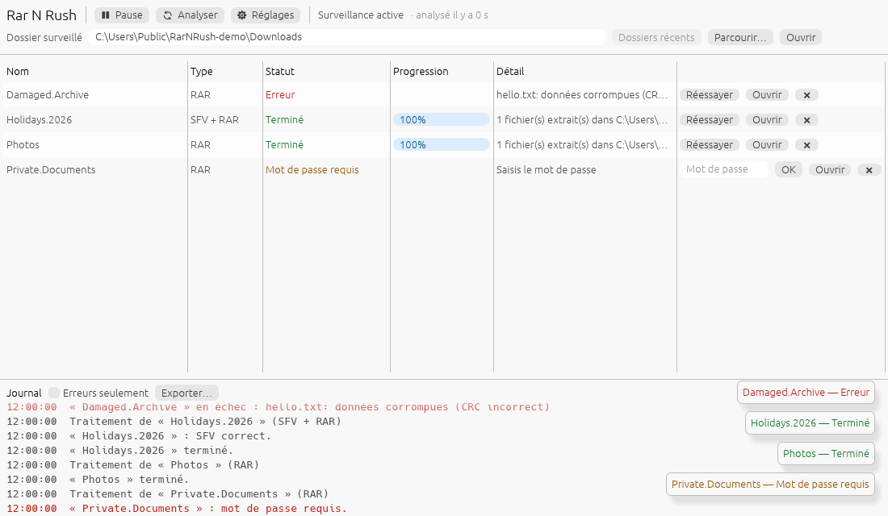
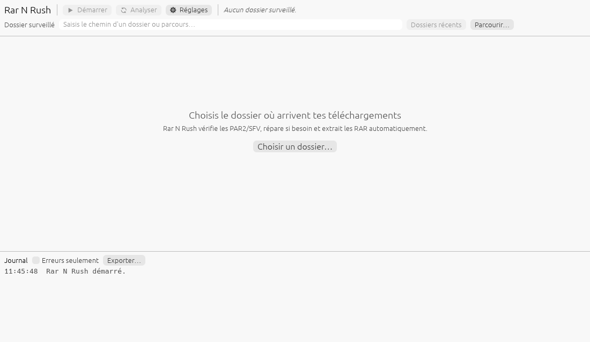
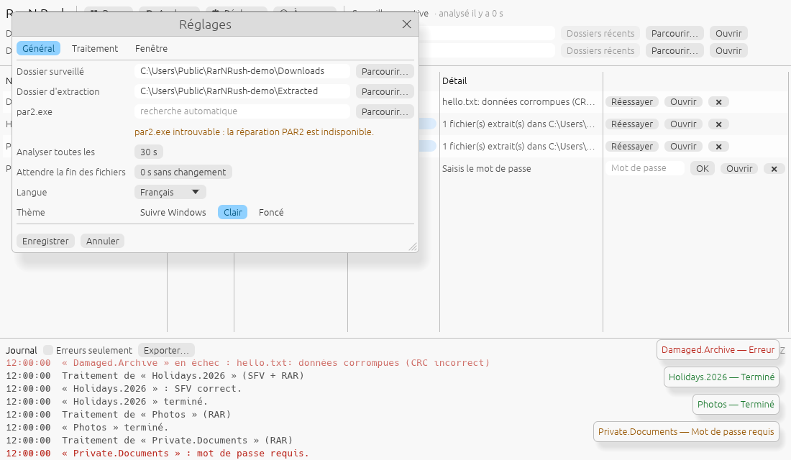

# Rar N Rush

[English](README.md) · **Français**

[](https://github.com/werewolf004/Rar-N-Rush/actions/workflows/ci.yml)
[](#licence)


Rar N Rush surveille ton dossier de téléchargements. Pour chaque téléchargement, il vérifie les données PAR2 ou SFV, répare les fichiers abîmés si besoin, puis extrait automatiquement les archives RAR.

Écrit en Rust avec une interface [egui](https://github.com/emilk/egui). Le concept s'inspire de l'application Par-N-Rar, mais le code est une réécriture indépendante.

<picture>
  <source media="(prefers-color-scheme: dark)" srcset="docs/screenshots/main-fr-dark.png">
  
</picture>

## Fonctionnalités

- **Surveillance d'un dossier** : le dossier surveillé (et, au choix, ses sous-dossiers) est analysé à intervalle régulier. Une extraction ne commence qu'une fois les fichiers stables : un téléchargement en cours n'est jamais touché.
- **PAR2** : vérification et réparation via `par2.exe`. Le zip de release contient [par2cmdline-turbo](https://github.com/animetosho/par2cmdline-turbo) 1.5.0 à côté de `rar-n-rush.exe` : ça marche sans rien installer. S'il manque des blocs de récupération, l'extraction attend et repart dès que de nouveaux fichiers arrivent.
- **SFV** : vérification CRC32 native.
- **RAR** : extraction avec la bibliothèque officielle UnRAR. Gère les archives multi-volumes (`.partN.rar`, `.rar` + `.r00`), les mots de passe (liste essayée automatiquement, ou saisie dans la fenêtre), les en-têtes chiffrés et les archives contenues dans une archive.
- **Sécurité des données** : par défaut, un fichier existant n'est jamais écrasé (il est gardé tel quel). Les chemins qui sortiraient du dossier de destination sont refusés. Les fichiers sources peuvent être envoyés à la corbeille, jamais supprimés définitivement.
- **Interface** : français ou anglais (suit Windows par défaut) ; thème clair, foncé ou automatique, qui suit Windows en direct ; icône facultative dans la zone de notification (réduire ou fermer vers cette zone) ; notifications Windows quand la fenêtre n'est pas au premier plan ; démarrage avec Windows en option ; une seule instance à la fois (la relancer ramène la fenêtre ouverte) ; la liste suit l'extraction en cours.
- **Rangement** (facultatif) : les autres fichiers (`.nfo`, échantillons…) suivent dans le dossier d'extraction, et les dossiers restés vides partent à la corbeille.
- **Installateur ou portable** : un installateur pour ton compte (sans droits administrateur) ou un zip à lancer de n'importe où.
- **Réglages fiables** : un seul fichier, retrouvé même si tu déplaces le programme ; une valeur invalide est remise par défaut individuellement (jamais tout le fichier) après une copie de sauvegarde, et tu en es averti.
- **Hors ligne** : aucune vérification de mise à jour, aucune télémétrie, aucun accès réseau. La mise à jour reste ton choix : télécharge une nouvelle release quand tu le veux.

## Installation

Chaque [release](https://github.com/werewolf004/Rar-N-Rush/releases) propose deux téléchargements avec le même programme ; choisis l'un des deux.

- **Installateur** (`rar-n-rush-vX.Y.Z-windows-x64.msi`, à partir de la v1.0.0) : installe pour ton compte seulement, dans `%LOCALAPPDATA%\Programs\Rar N Rush`, sans droits administrateur. Il ajoute un raccourci dans le menu Démarrer et une entrée dans **Paramètres → Applications** pour le désinstaller. Les réglages sont gardés dans `%APPDATA%\RarNRush`. Un installateur plus récent remplace la version installée et garde tes réglages, tes mots de passe et « Démarrer avec Windows ».
- **Zip portable** (`rar-n-rush-vX.Y.Z-windows-x64.zip`) : rien n'est installé. Décompresse-le où tu veux et lance `rar-n-rush.exe` ; les réglages sont gardés à côté.

1. Télécharge le fichier choisi.
2. Vérifie-le avec le fichier `.sha256` publié à côté :
   ```powershell
   Get-FileHash .\rar-n-rush-vX.Y.Z-windows-x64.msi -Algorithm SHA256
   ```
   Tu peux aussi vérifier qu'il a bien été produit par le workflow de release de ce dépôt (provenance de build signée, depuis la v0.3.0 pour le zip et la v1.0.0 pour l'installateur ; nécessite la [GitHub CLI](https://cli.github.com/)) :
   ```powershell
   gh attestation verify .\rar-n-rush-vX.Y.Z-windows-x64.msi --repo werewolf004/Rar-N-Rush
   ```
3. Lance l'installateur, ou décompresse le zip et lance `rar-n-rush.exe`. Le programme n'est pas signé : Windows SmartScreen peut t'avertir la première fois, clique sur **Informations complémentaires → Exécuter quand même**.
4. La réparation PAR2 utilise le `par2.exe` fourni avec. Pour en utiliser un autre, indique son chemin dans les réglages (ou retire celui fourni et mets le tien dans le `PATH`). Rar N Rush ne télécharge jamais rien.

Configuration requise : Windows 10 ou 11 (64 bits).

## Prise en main

Au premier lancement, choisis le dossier où arrivent tes téléchargements :

<picture>
  <source media="(prefers-color-scheme: dark)" srcset="docs/screenshots/onboarding-fr.png">
  
</picture>

La surveillance démarre tout de suite. Tu peux changer de dossier à tout moment, même pendant un traitement, depuis la barre **Dossier surveillé** en haut de la fenêtre : saisis un chemin et valide avec Entrée (Échap annule), choisis-en un dans **Dossiers récents**, ou clique sur **Parcourir…**. **Ouvrir** affiche le dossier dans l'Explorateur. La barre **Dossier d'extraction** juste en dessous fonctionne de la même façon ; laissée vide, les archives sont extraites directement dans le dossier surveillé.

Chaque extraction apparaît dans la liste avec son statut :

| Statut | Signification |
|---|---|
| En attente | Des fichiers arrivent encore. |
| Prêt | Complet, attend son tour. |
| Vérification / Réparation / Extraction | En cours de traitement. |
| Mot de passe requis | Saisis le mot de passe dans la ligne et valide avec Entrée. |
| Réparation impossible | Pas assez de blocs PAR2 : l'extraction attend d'autres fichiers. |
| Terminé | Extrait avec succès. |
| Erreur | Voir la colonne Détail et le journal ; **Réessayer** la relance. |
| Ignoré | Ignoré par toi ; **Réessayer** le traite quand même. |

Ouvre **Réglages** pour changer les dossiers, les délais, la langue, le thème et le comportement. Chaque option est décrite dans [docs/OPTIONS.fr.md](docs/OPTIONS.fr.md).

| Raccourci | Action |
|---|---|
| **F5** | Analyser le dossier surveillé maintenant |
| **F1** | À propos : version, licence et liens |
| **Ctrl+,** | Ouvrir les réglages |
| **Échap** | Fermer les réglages (demande d'abord si quelque chose a changé) ; dans le champ du dossier surveillé, annuler la saisie |
| **Entrée** | Dans le champ du dossier surveillé, surveiller le dossier saisi ; dans un champ de mot de passe, essayer le mot de passe |
| **↑ / ↓** | Sélectionner une ligne dans la liste (ou cliquer dessus) |
| **Suppr** | Retirer la ligne sélectionnée de la liste (ses fichiers ne sont pas touchés) |
| **Entrée** (ligne sélectionnée) | Ouvrir le dossier de la ligne sélectionnée |

La fenêtre se rouvre à la taille et à la position qu'elle avait à la fermeture. Quand une extraction se termine, échoue ou demande un mot de passe, un court message apparaît quelques secondes en bas à droite, sans t'interrompre.

<picture>
  <source media="(prefers-color-scheme: dark)" srcset="docs/screenshots/settings-fr-dark.png">
  
</picture>

## Documentation

| Document | Contenu |
|---|---|
| [docs/USER-GUIDE.fr.md](docs/USER-GUIDE.fr.md) | Guide utilisateur : chaque écran, pas à pas, avec captures |
| [docs/OPTIONS.fr.md](docs/OPTIONS.fr.md) | Chaque réglage : nom, valeur par défaut, plage, effet |
| [docs/DEPENDENCIES.fr.md](docs/DEPENDENCIES.fr.md) | Chaque dépendance et son rôle |
| [docs/THIRD-PARTY-LICENSES.md](docs/THIRD-PARTY-LICENSES.md) | Les 234 crates du binaire, avec leurs licences |
| [CHANGELOG.fr.md](CHANGELOG.fr.md) | Les changements de chaque version |
| [ROADMAP.fr.md](ROADMAP.fr.md) | La suite prévue |
| [CONTRIBUTING.fr.md](CONTRIBUTING.fr.md) | Compiler, tester et contribuer |
| [SECURITY.fr.md](SECURITY.fr.md) | Modèle de sécurité et signalement d'une faille |

## Compiler depuis les sources

Il faut Rust 1.95 ou plus récent et les outils de build C++ de Visual Studio (MSVC), qui compilent UnRAR.

```bash
cargo build --release
```

L'exécutable est produit dans `target/release/rar-n-rush.exe`. Voir [CONTRIBUTING.fr.md](CONTRIBUTING.fr.md) pour les tests et contrôles.

## Licence

Rar N Rush est distribué au choix sous la [licence MIT](LICENSE-MIT) ou la [licence Apache 2.0](LICENSE-APACHE).

La bibliothèque UnRAR embarquée est sous licence UnRAR : elle autorise l'extraction d'archives mais interdit d'utiliser son code pour recréer l'algorithme de compression RAR. Voir [docs/THIRD-PARTY-LICENSES.md](docs/THIRD-PARTY-LICENSES.md).
