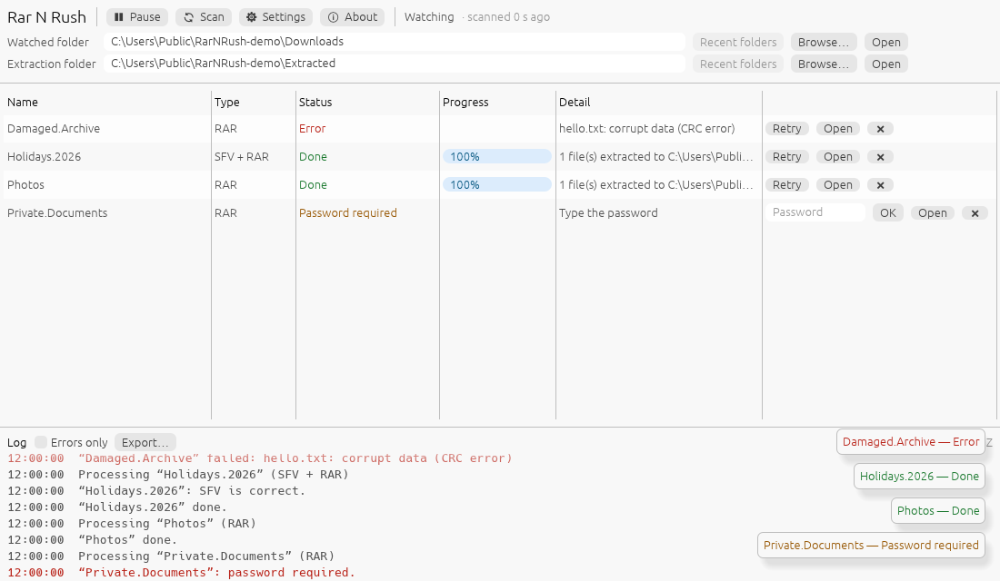
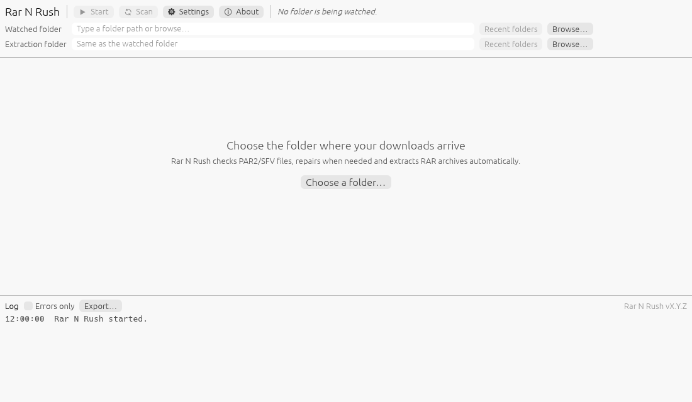
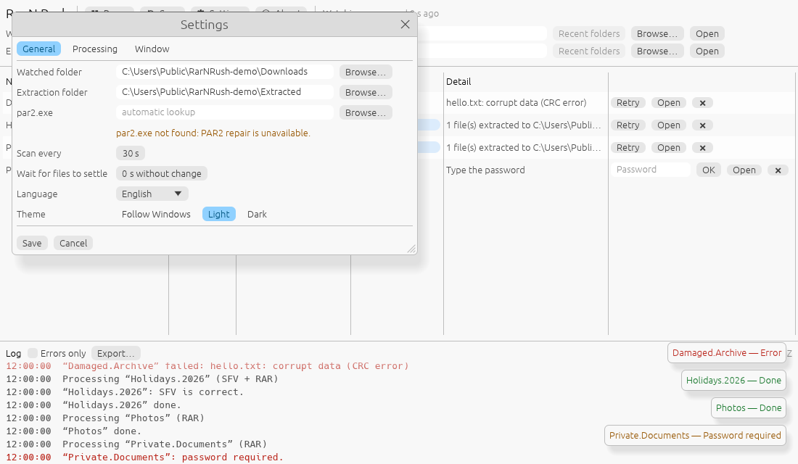

# Rar N Rush

**English** · [Français](README.fr.md)

[](https://github.com/werewolf004/Rar-N-Rush/actions/workflows/ci.yml)
[](#license)


Rar N Rush watches your download folder. For each set of files, it verifies the PAR2 or SFV data, repairs damaged files when needed, then extracts the RAR archives automatically.

Written in Rust with an [egui](https://github.com/emilk/egui) interface. The concept is inspired by the Par-N-Rar application, but the code is an independent rewrite.

<picture>
  <source media="(prefers-color-scheme: dark)" srcset="docs/screenshots/main-en-dark.png">
  
</picture>

## Features

- **Folder monitoring**: the watched folder (and optionally its sub-folders) is scanned at a regular interval. A set is only processed once its files have stopped changing, so downloads in progress are never touched.
- **PAR2**: verification and repair through `par2.exe`. The release zip ships [par2cmdline-turbo](https://github.com/animetosho/par2cmdline-turbo) 1.5.0 next to `rar-n-rush.exe`, so it works out of the box. When there are not enough recovery blocks, the set waits and is retried as soon as new files arrive.
- **SFV**: native CRC32 verification.
- **RAR**: extraction with the official UnRAR library. Supports multi-volume archives (`.partN.rar`, `.rar` + `.r00`), passwords (a list tried automatically, or typed in the window), encrypted headers and archives nested inside archives.
- **Data safety**: existing files are never overwritten by default (`name (1).ext` is used instead). Paths that would escape the destination folder are refused. Source files can be sent to the Recycle Bin, never deleted permanently.
- **Interface**: English or French (follows Windows by default); light, dark or automatic theme following Windows live; optional icon in the notification area (minimise or close to tray); Windows notifications while the window is not in front; optional start with Windows; one instance at a time (starting it again brings the open window back); the list follows the set being processed.
- **Tidy-up** (optional): the other files of a set (`.nfo`, samples…) follow it to the destination, and folders left empty go to the Recycle Bin.
- **Installer or portable**: a per-user installer (no administrator rights) or a zip to run from anywhere.
- **Reliable settings**: one file, found again even if you move the program; invalid values are reset one by one (never the whole file) after a backup copy, and you are told about it.
- **Offline**: no update check, no telemetry, no network access at all. Updating is your choice: download a new release when you want one.

## Installation

Each [release](https://github.com/werewolf004/Rar-N-Rush/releases) offers two downloads with the same program; pick one.

- **Installer** (`rar-n-rush-vX.Y.Z-windows-x64.msi`, from v1.0.0): installs for your account only, in `%LOCALAPPDATA%\Programs\Rar N Rush`, without administrator rights. It adds a Start menu shortcut and an entry in **Settings → Apps** to remove it. Settings are kept in `%APPDATA%\RarNRush`. A newer installer replaces the installed version and keeps your settings, passwords and "Start with Windows".
- **Portable zip** (`rar-n-rush-vX.Y.Z-windows-x64.zip`): nothing is installed. Unzip it anywhere and run `rar-n-rush.exe`; settings are kept next to it.

1. Download the file you chose.
2. Check it with the `.sha256` file published next to it:
   ```powershell
   Get-FileHash .\rar-n-rush-vX.Y.Z-windows-x64.msi -Algorithm SHA256
   ```
   You can also check that it was built by this repository's release workflow (signed build provenance, from v0.3.0 for the zip and v1.0.0 for the installer; requires the [GitHub CLI](https://cli.github.com/)):
   ```powershell
   gh attestation verify .\rar-n-rush-vX.Y.Z-windows-x64.msi --repo werewolf004/Rar-N-Rush
   ```
3. Run the installer, or unzip the zip and run `rar-n-rush.exe`. The program is not signed, so Windows SmartScreen may warn you the first time: **More info → Run anyway**.
4. PAR2 repair uses the `par2.exe` shipped with it. To use another build, set its path in the settings (or remove the bundled one and put yours in `PATH`). Rar N Rush never downloads anything.

Requirements: Windows 10 or 11 (64-bit).

## Getting started

On first launch, choose the folder where your downloads arrive:

<picture>
  <source media="(prefers-color-scheme: dark)" srcset="docs/screenshots/onboarding-en.png">
  
</picture>

Monitoring starts right away. You can switch to another folder at any time, even while sets are being processed, from the **Watched folder** bar at the top of the window: type a path and press Enter (Esc cancels), pick one under **Recent folders**, or click **Browse…**. **Open** shows the folder in File Explorer. The **Extraction folder** bar just below works the same way; left empty, archives are extracted straight into the watched folder.

Each set of files appears in the list with its status:

| Status | Meaning |
|---|---|
| Waiting | Files are still arriving. |
| Ready | Complete, waiting for its turn. |
| Verifying / Repairing / Extracting | Being processed. |
| Password required | Type the password in the row and press Enter. |
| Repair impossible | Not enough PAR2 blocks: the set waits for more files. |
| Done | Extracted successfully. |
| Error | See the Detail column and the log; **Retry** re-runs the set. |
| Skipped | Ignored by you; **Retry** processes it anyway. |

Open **Settings** to change the folders, timings, language, theme and behaviour. Every option is described in [docs/OPTIONS.md](docs/OPTIONS.md).

| Shortcut | Action |
|---|---|
| **F5** | Scan the watched folder now |
| **F1** | About: version, licence and links |
| **Ctrl+,** | Open the settings |
| **Esc** | Close the settings (asks first if something changed); in the watched-folder field, cancel the edit |
| **Enter** | In the watched-folder field, watch the folder typed; in a password field, try the password |
| **↑ / ↓** | Select a set in the list (or click it) |
| **Del** | Remove the selected set from the list (its files are not touched) |
| **Enter** (set selected) | Open the folder of the selected set |

The window reopens at the size and position it had when you closed it. When a set finishes, fails or needs a password, a short notice appears for a few seconds in the bottom-right corner, without interrupting you.

<picture>
  <source media="(prefers-color-scheme: dark)" srcset="docs/screenshots/settings-en-dark.png">
  
</picture>

## Documentation

| Document | Content |
|---|---|
| [docs/USER-GUIDE.md](docs/USER-GUIDE.md) | User guide: every screen, step by step, with screenshots |
| [docs/OPTIONS.md](docs/OPTIONS.md) | Every setting: name, default, range, effect |
| [docs/DEPENDENCIES.md](docs/DEPENDENCIES.md) | Every dependency and why it is used |
| [docs/THIRD-PARTY-LICENSES.md](docs/THIRD-PARTY-LICENSES.md) | All 229 crates in the binary, with licences |
| [CHANGELOG.md](CHANGELOG.md) | Changes per release |
| [ROADMAP.md](ROADMAP.md) | What comes next |
| [CONTRIBUTING.md](CONTRIBUTING.md) | How to build, test and contribute |
| [SECURITY.md](SECURITY.md) | Security model and how to report a vulnerability |

## Building from source

Requirements: Rust 1.95 or later and the Visual Studio C++ build tools (MSVC), used to compile UnRAR.

```bash
cargo build --release
```

The executable is written to `target/release/rar-n-rush.exe`. See [CONTRIBUTING.md](CONTRIBUTING.md) for tests and checks.

## License

Rar N Rush is distributed under the terms of either the [MIT license](LICENSE-MIT) or the [Apache License 2.0](LICENSE-APACHE), at your option.

The embedded UnRAR library is distributed under the UnRAR licence: it allows extracting archives but forbids using its code to re-create the RAR compression algorithm. See [docs/THIRD-PARTY-LICENSES.md](docs/THIRD-PARTY-LICENSES.md).
