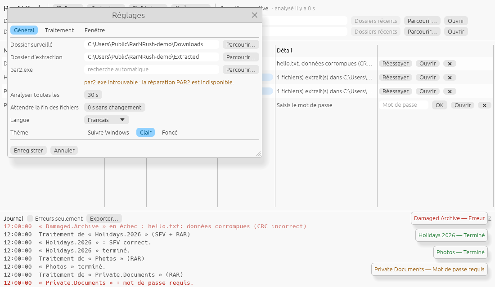
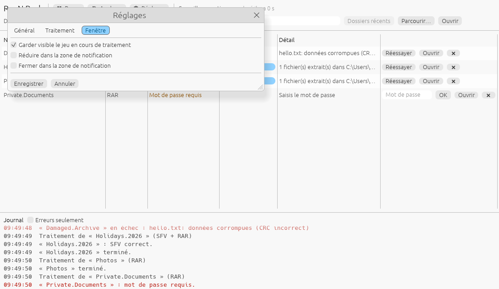

# Référence des réglages

[English](OPTIONS.md) · **Français**

Chaque réglage est accessible dans la fenêtre **Réglages** et enregistré dans `rar-n-rush.toml`. Les changements s'appliquent dès le clic sur **Enregistrer** ; le fichier est écrit de façon atomique (un plantage ne peut jamais le laisser à moitié écrit).

## Emplacement du fichier

Au démarrage, Rar N Rush cherche le fichier dans cet ordre et utilise **le premier qui existe** : ta configuration est donc retrouvée même si tu déplaces l'exécutable.

1. à côté de `rar-n-rush.exe` (mode portable) ;
2. dans `%APPDATA%\RarNRush`.

Au tout premier démarrage (aucun fichier nulle part), il est créé à côté de `rar-n-rush.exe`, ou dans `%APPDATA%\RarNRush` si le dossier du programme est protégé en écriture (par exemple sous `Program Files`).

## Si le fichier pose problème

Tes réglages ne sont jamais perdus en silence :

- une clé absente prend sa valeur par défaut (un fichier ancien ou partiel reste valide) ; une clé inconnue est ignorée ;
- chaque clé est lue séparément : **les valeurs valides sont conservées**, seules les invalides reviennent à leur valeur par défaut ;
- un nombre hors plage est ramené dans la plage autorisée ;
- le marqueur d'ordre des octets (BOM) ajouté par le Bloc-notes est accepté ;
- dès qu'une valeur est remise par défaut, le fichier d'origine est d'abord copié sous `rar-n-rush.toml.<date-heure>.bak`, et un bandeau en haut de la fenêtre indique les clés concernées et l'emplacement de la copie.

La fenêtre des réglages a trois pages : **Général** (dossiers, délais, langue, thème), **Traitement** (comportement, nettoyage, mots de passe) et **Fenêtre**. Elle s'ouvre avec **Réglages** ou **Ctrl+,**.

- **Enregistrer** est désactivé tant qu'une valeur est fausse ; le problème s'affiche juste au-dessus (dossier surveillé inexistant, destination qui est un fichier ou où l'on ne peut pas écrire, chemin de `par2.exe` sans fichier). Une destination qui n'existe pas encore est acceptée : elle est créée à la première extraction.
- **Annuler**, le ✕ de la fenêtre et **Échap** la ferment ; s'il y a des modifications non enregistrées, ils demandent d'abord **Abandonner tes modifications ?** (**Abandonner** ou **Continuer**).



## Dossiers *(page Général)*

| Clé | Libellé dans la fenêtre | Type | Défaut | Effet |
|---|---|---|---|---|
| `watch_dir` | Dossier surveillé | chemin | *(vide)* | Dossier analysé pour trouver de nouveaux jeux. Vide : la surveillance ne peut pas démarrer. Modifiable à tout moment dans la barre **Dossier surveillé** de la fenêtre principale : saisis un chemin et valide avec Entrée, choisis-en un dans **Dossiers récents**, ou utilise **Parcourir…**. Un dossier inexistant est refusé. |
| `recent_watch_dirs` | Dossiers récents *(fenêtre principale)* | liste de chemins | `[]` | Dossiers surveillés récemment, du plus récent au plus ancien, proposés par **Dossiers récents**. Tenue à jour automatiquement, 10 entrées au plus, sans doublon (casse ignorée). |
| `extract_dir` | Destination | chemin | *(vide)* | Dossier d'extraction. Vide : à côté des fichiers sources. S'il se trouve dans le dossier surveillé, il est exclu des analyses. |
| `par2_path` | par2.exe | chemin | *(vide)* | Chemin de `par2.exe`. Vide : recherche automatique, d'abord à côté de `rar-n-rush.exe`, puis dans le `PATH`. La fenêtre affiche le chemin trouvé, ou un avertissement. |

## Délais *(page Général)*

| Clé | Libellé dans la fenêtre | Type | Défaut | Plage | Effet |
|---|---|---|---|---|---|
| `scan_interval_secs` | Analyser toutes les | secondes | `15` | 2–3600 | Délai entre deux analyses du dossier surveillé. Le bouton **Analyser** force une analyse immédiate. |
| `stable_secs` | Attendre la fin des fichiers | secondes | `10` | 0–3600 | Un jeu n'est traité qu'une fois ses fichiers (nombre, taille, date de modification) inchangés pendant cette durée. |

## Comportement *(page Traitement)*


| Clé | Libellé dans la fenêtre | Type | Défaut | Effet |
|---|---|---|---|---|
| `recursive` | Analyser aussi les sous-dossiers | booléen | `true` | Analyse les sous-dossiers, jusqu'à 8 niveaux. Les liens symboliques ne sont pas suivis. |
| `create_subfolder` | Extraire dans un sous-dossier au nom du jeu | booléen | `true` | Extrait `Vacances.part1.rar` dans `<destination>\Vacances\`. Les caractères interdits par Windows sont remplacés par `_`. |
| `extract_nested` | Extraire les archives RAR contenues dans une archive | booléen | `true` | Extrait les archives trouvées dans une archive extraite (jusqu'à 3 niveaux), puis supprime ces archives internes. |
| `overwrite_existing` | Écraser les fichiers existants | booléen | `false` | À `false`, un fichier existant est conservé et la copie extraite est nommée `nom (1).ext`, `nom (2).ext`… |
| `delete_after_success` | Envoyer les fichiers PAR2/SFV/RAR à la corbeille après succès | booléen | `false` | Après un traitement réussi, envoie à la corbeille les fichiers PAR2, le SFV, les volumes RAR et les sauvegardes de par2 (`fichier.1`). Les fichiers vérifiés qui ne sont pas des RAR sont toujours conservés. |
| `autostart` | Démarrer la surveillance au lancement | booléen | `true` | Démarre la surveillance au lancement si un dossier surveillé est défini. |

## Mots de passe *(page Traitement)*

| Clé | Libellé dans la fenêtre | Type | Défaut | Effet |
|---|---|---|---|---|
| `passwords` | Mots de passe à essayer (un par ligne) | liste de textes | `[]` | Essayés dans l'ordre sur les archives protégées. Un mot de passe saisi dans une ligne de la fenêtre principale est essayé en premier. |

> Depuis la v0.3.0, les mots de passe sont conservés dans le **Gestionnaire d'identifiants Windows** (entrées `passwords*.RarNRush`, visibles dans Panneau de configuration → Gestionnaire d'identification → Informations d'identification Windows), et non dans `rar-n-rush.toml`. Les mots de passe trouvés dans le fichier d'une version précédente y sont déplacés au lancement ; le fichier n'est réécrit sans eux qu'une fois le Gestionnaire relu avec la liste complète.
>
> Si le Gestionnaire d'identifiants est inutilisable, rien n'est perdu : les mots de passe restent dans le fichier de réglages (en clair, comme avant), l'aide sous le champ l'indique et un bandeau explique pourquoi.

## Après un traitement réussi *(page Traitement)*

| Clé | Libellé dans la fenêtre | Type | Défaut | Effet |
|---|---|---|---|---|
| `move_extra_files` | Déplacer les autres fichiers du jeu (.nfo, extraits…) vers la destination | booléen | `false` | Après l'extraction, déplace vers la destination les fichiers du dossier du jeu qui ne sont pas des sources PAR2/SFV/RAR (`.nfo`, `.jpg`, fichiers vérifiés qui ne sont pas des RAR…). **Uniquement si le jeu est seul dans son propre sous-dossier** du dossier surveillé : un jeu posé directement dans le dossier surveillé, ou qui partage son dossier avec d'autres jeux, garde ses fichiers (le journal indique pourquoi). Rien n'est déplacé si la destination est le dossier du jeu lui-même. Un fichier existant est conservé (`nom (1).ext`) sauf si l'écrasement est activé. |
| `delete_empty_dirs` | Envoyer les dossiers restés vides à la corbeille | booléen | `false` | Après un traitement réussi, envoie le dossier du jeu à la corbeille s'il est entièrement vide, puis ses dossiers parents tant qu'ils sont vides. Le dossier surveillé lui-même n'est jamais supprimé. À combiner avec les deux options ci-dessus pour ne rien laisser derrière. |

## Fenêtre *(page Fenêtre)*



| Clé | Libellé dans la fenêtre | Type | Défaut | Effet |
|---|---|---|---|---|
| `follow_active` | Garder visible le jeu en cours de traitement | booléen | `true` | Fait défiler la liste jusqu'à chaque nouveau jeu en cours de traitement, une seule fois : tu restes libre de faire défiler entre-temps. |
| `minimize_to_tray` | Réduire dans la zone de notification | booléen | `false` | Réduire la fenêtre la masque ; une icône dans la zone de notification la fait revenir (clic, ou **Afficher Rar N Rush** dans son menu). |
| `window` | *(aucun, enregistré automatiquement)* | table | *(aucune)* | Taille et position de la fenêtre principale, enregistrées à la fermeture et restaurées au lancement suivant : `x`, `y`, `width`, `height` en pixels et `maximized`. Les valeurs hors limites sont corrigées (minimum 720 × 420). Supprime la table pour revenir à la taille par défaut. |
| `close_to_tray` | Fermer dans la zone de notification | booléen | `false` | Le ✕ de la fenêtre la masque au lieu de quitter ; la surveillance continue. Pour quitter, choisis **Quitter** dans le menu de l'icône. Si l'icône ne peut pas être créée, la fenêtre se ferme normalement et la fenêtre des réglages en donne la raison. |

## Apparence *(page Général)*

| Clé | Libellé dans la fenêtre | Valeurs | Défaut | Effet |
|---|---|---|---|---|
| `language` | Langue | `system`, `english`, `french` | `system` | Langue de l'interface. `system` suit la langue d'affichage de Windows (français si elle commence par `fr`, anglais sinon). |
| `theme` | Thème | `system`, `light`, `dark` | `system` | `system` suit le réglage clair/foncé de Windows, en direct. |

## Exemple de fichier

```toml
watch_dir = 'D:\Telechargements'
recent_watch_dirs = ['D:\Telechargements', 'E:\Usenet']
extract_dir = 'D:\Extraits'
create_subfolder = true
recursive = true
par2_path = ''
delete_after_success = false
extract_nested = true
overwrite_existing = false
scan_interval_secs = 15
stable_secs = 10
passwords = []
autostart = true
move_extra_files = false
delete_empty_dirs = false
follow_active = true
minimize_to_tray = false
close_to_tray = false

[window]
x = 120
y = 80
width = 1100
height = 680
maximized = false
language = "system"
theme = "system"
```

## Autres fichiers

| Fichier | Contenu |
|---|---|
| `rar-n-rush-processed.txt` | Une ligne par jeu déjà traité ou ignoré, pour ne pas le retraiter après un redémarrage. Supprime une ligne (ou le fichier) pour retraiter un jeu. |
