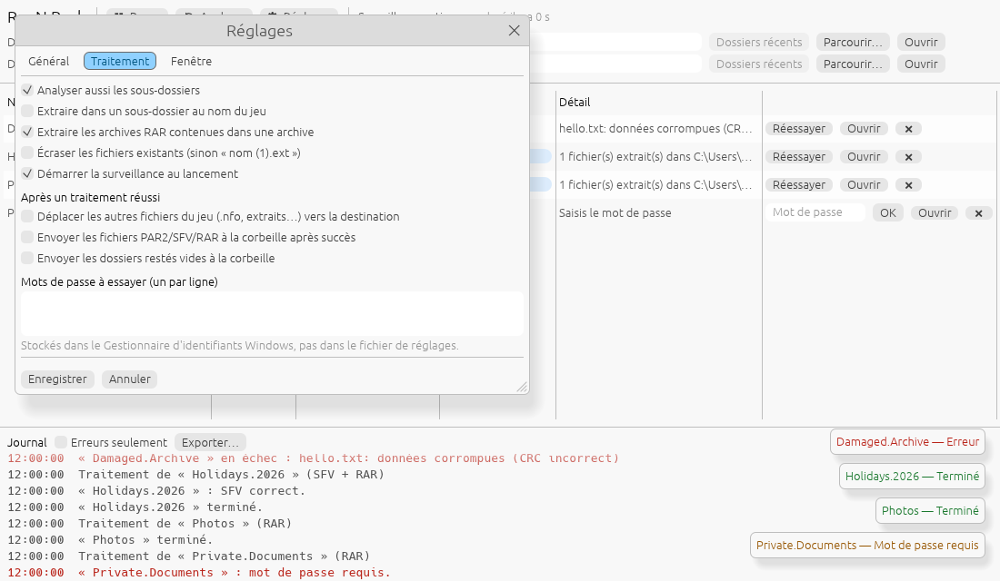

# Référence des réglages

[English](OPTIONS.md) · **Français**

Chaque réglage est accessible dans la fenêtre **Réglages** et enregistré dans `rar-n-rush.toml`. Les changements s'appliquent dès le clic sur **Enregistrer** ; le fichier est écrit de façon atomique (un plantage ne peut jamais le laisser à moitié écrit).

## Emplacement du fichier

Au démarrage, Rar N Rush cherche le fichier dans cet ordre et utilise **le premier qui existe** : ta configuration est donc retrouvée même si tu déplaces l'exécutable.

1. à côté de `rar-n-rush.exe` (mode portable) ;
2. dans `%APPDATA%\RarNRush`.

Au tout premier démarrage (aucun fichier nulle part), il est créé à côté de `rar-n-rush.exe`, ou dans `%APPDATA%\RarNRush` si le dossier du programme est protégé en écriture (par exemple sous `Program Files`).

Le programme posé par l'installateur (`.msi`) utilise toujours `%APPDATA%\RarNRush` : son dossier contient un fichier repère `rar-n-rush.installed` qui désactive le mode portable. Un fichier de réglages déjà présent à côté de ce `rar-n-rush.exe` resterait prioritaire, pour que rien ne soit laissé de côté.

## Si le fichier pose problème

Tes réglages ne sont jamais perdus en silence :

- une clé absente prend sa valeur par défaut (un fichier ancien ou partiel reste valide) ; une clé inconnue est ignorée ;
- chaque clé est lue séparément : **les valeurs valides sont conservées**, seules les invalides reviennent à leur valeur par défaut ;
- un nombre hors plage est ramené dans la plage autorisée ;
- le marqueur d'ordre des octets (BOM) ajouté par le Bloc-notes est accepté, de même qu'un fichier enregistré en « ANSI » (Windows-1252) au lieu d'UTF-8 : toutes les valeurs sont conservées, l'original est copié à côté, et le fichier est réécrit en UTF-8 ;
- un fichier totalement illisible (verrouillé, droits) n'est jamais remplacé : les valeurs par défaut sont utilisées pour la session, et l'enregistrement le met d'abord de côté ou, si cela échoue aussi, n'écrit rien ;
- dès qu'une valeur est remise par défaut, le fichier d'origine est d'abord copié sous `rar-n-rush.toml.<date-heure>.bak`, et un bandeau en haut de la fenêtre indique les clés concernées et l'emplacement de la copie.

La fenêtre des réglages a trois pages : **Général** (dossiers, délais, langue, thème, mises à jour), **Traitement** (comportement, nettoyage, mots de passe) et **Fenêtre**. Elle s'ouvre avec **Réglages** ou **Ctrl+,**.

- **Enregistrer** est désactivé tant qu'une valeur est fausse ; le problème s'affiche juste au-dessus (dossier surveillé inexistant, destination qui est un fichier ou où l'on ne peut pas écrire, chemin de `par2.exe` sans fichier). Une destination qui n'existe pas encore est acceptée : elle est créée à la première extraction. Un dossier surveillé ou un `par2.exe` déjà réglé avant l'ouverture de la fenêtre et introuvable pour l'instant (disque débranché, partage réseau hors ligne) ne donne qu'un avertissement : les autres réglages peuvent toujours être enregistrés.
- **Annuler**, le ✕ de la fenêtre et **Échap** la ferment ; s'il y a des modifications non enregistrées, ils demandent d'abord **Abandonner tes modifications ?** (**Abandonner** ou **Continuer**).


## Dossiers *(page Général)*

| Clé | Libellé dans la fenêtre | Type | Défaut | Effet |
|---|---|---|---|---|
| `watch_dir` | Dossier surveillé | chemin | *(vide)* | Dossier analysé pour trouver de nouveaux téléchargements à extraire. Vide : la surveillance ne peut pas démarrer. Modifiable à tout moment dans la barre **Dossier surveillé** de la fenêtre principale : saisis un chemin et valide avec Entrée, choisis-en un dans **Dossiers récents**, ou utilise **Parcourir…**. Un dossier inexistant est refusé. |
| `recent_watch_dirs` | Dossiers récents *(fenêtre principale)* | liste de chemins | `[]` | Dossiers surveillés récemment, du plus récent au plus ancien, proposés par **Dossiers récents**. Tenue à jour automatiquement, 10 entrées au plus, sans doublon (casse ignorée). |
| `extract_dir` | Dossier d'extraction | chemin | *(vide)* | Dossier où les archives sont extraites. Vide : le dossier surveillé. Modifiable aussi à tout moment dans la barre **Dossier d'extraction** de la fenêtre principale, comme le dossier surveillé (un champ vide revient au dossier surveillé). S'il se trouve dans le dossier surveillé, il est exclu des analyses. |
| `recent_extract_dirs` | Dossiers récents *(fenêtre principale, dossier d'extraction)* | liste de chemins | `[]` | Dossiers d'extraction utilisés récemment, du plus récent au plus ancien. Mêmes règles que `recent_watch_dirs`. |
| `par2_path` | par2.exe | chemin | *(vide)* | Chemin de `par2.exe`. Vide : recherche automatique, d'abord à côté de `rar-n-rush.exe`, puis dans le `PATH`. La fenêtre affiche le chemin trouvé, ou un avertissement. |

## Délais *(page Général)*

| Clé | Libellé dans la fenêtre | Type | Défaut | Plage | Effet |
|---|---|---|---|---|---|
| `scan_interval_secs` | Analyser toutes les | secondes | `15` | 2–3600 | Délai entre deux analyses du dossier surveillé. Le bouton **Analyser** force une analyse immédiate. |
| `stable_secs` | Attendre la fin des fichiers | secondes | `10` | 0–3600 | Une extraction ne commence qu'une fois les fichiers (nombre, taille, date de modification) inchangés pendant cette durée. |

## Comportement *(page Traitement)*



| Clé | Libellé dans la fenêtre | Type | Défaut | Effet |
|---|---|---|---|---|
| `recursive` | Analyser aussi les sous-dossiers | booléen | `true` | Analyse les sous-dossiers, jusqu'à 8 niveaux. Les liens symboliques ne sont pas suivis. |
| `create_subfolder` | Extraire dans un sous-dossier au nom de l'archive | booléen | `false` | Désactivé : les fichiers sont extraits directement dans le dossier d'extraction. Activé : `Vacances.part1.rar` est extrait dans `<dossier d'extraction>\Vacances\`. Les caractères interdits par Windows sont remplacés par `_`. |
| `extract_nested` | Extraire les archives RAR contenues dans une archive | booléen | `true` | Extrait les archives trouvées dans une archive extraite (jusqu'à 3 niveaux), puis supprime ces archives internes. |
| `overwrite_existing` | Écraser les fichiers existants | booléen | `false` | À `false`, un fichier déjà présent dans le dossier d'extraction est gardé tel quel : il n'est pas extrait de nouveau et aucune deuxième copie n'est créée. À `true`, il est remplacé. L'activer demande d'abord une confirmation, car un fichier écrasé ne peut pas être récupéré. |
| `delete_after_success` | Envoyer les fichiers PAR2/SFV/RAR à la corbeille après succès | booléen | `false` | Après un traitement réussi, envoie à la corbeille les fichiers PAR2, le SFV, les volumes RAR et les sauvegardes de par2 (`fichier.1`). Les fichiers vérifiés qui ne sont pas des RAR sont toujours conservés. |
| `autostart` | Démarrer la surveillance au lancement | booléen | `true` | Démarre la surveillance au lancement si un dossier surveillé est défini. |

## Mots de passe *(page Traitement)*

| Clé | Libellé dans la fenêtre | Type | Défaut | Effet |
|---|---|---|---|---|
| `passwords` | Mots de passe à essayer (un par ligne) | liste de textes | `[]` | Essayés dans l'ordre sur les archives protégées. Un mot de passe saisi dans une ligne de la fenêtre principale est essayé en premier. |

> Depuis la v0.3.0, les mots de passe sont conservés dans le **Gestionnaire d'identifiants Windows** (entrées `passwords*.RarNRush`, visibles dans Panneau de configuration → Gestionnaire d'identification → Informations d'identification Windows), et non dans `rar-n-rush.toml`. Les mots de passe trouvés dans le fichier d'une version précédente y sont déplacés au lancement ; le fichier n'est réécrit sans eux qu'une fois le Gestionnaire relu avec la liste complète.
>
> Si le Gestionnaire d'identifiants est inutilisable, rien n'est perdu : les mots de passe restent dans le fichier de réglages (en clair, comme avant), l'aide sous le champ l'indique et un bandeau explique pourquoi.

## Après un traitement réussi *(page Traitement)*

| Clé | Libellé dans la fenêtre | Type | Défaut | Effet |
|---|---|---|---|---|
| `move_extra_files` | Déplacer les autres fichiers (.nfo, échantillons…) vers le dossier d'extraction | booléen | `false` | Après l'extraction, déplace vers le dossier d'extraction les fichiers du dossier de l'archive qui ne sont pas des sources PAR2/SFV/RAR (`.nfo`, `.jpg`, fichiers vérifiés qui ne sont pas des RAR…). **Uniquement si l'archive est seule dans son propre sous-dossier** du dossier surveillé : une archive posée directement dans le dossier surveillé, ou qui partage son dossier avec d'autres archives, garde ses fichiers (le journal indique pourquoi). Rien n'est déplacé si le dossier d'extraction est le dossier de l'archive lui-même. Un fichier du même nom déjà présent est gardé (l'autre reste où il était), sauf si l'écrasement est activé. |
| `delete_empty_dirs` | Envoyer les dossiers restés vides à la corbeille | booléen | `false` | Après un traitement réussi, envoie le dossier de l'archive à la corbeille s'il est entièrement vide, puis ses dossiers parents tant qu'ils sont vides. Le dossier surveillé lui-même n'est jamais supprimé. À combiner avec les deux options ci-dessus pour ne rien laisser derrière. |

## Fenêtre *(page Fenêtre)*


| Clé | Libellé dans la fenêtre | Type | Défaut | Effet |
|---|---|---|---|---|
| `follow_active` | Garder visible l'extraction en cours | booléen | `true` | Fait défiler la liste jusqu'à chaque nouvelle extraction en cours, une seule fois : tu restes libre de faire défiler entre-temps. |
| `log_to_file` | Écrire aussi le journal dans rar-n-rush.log | booléen | `true` | Écrit chaque ligne du journal, avec sa date, dans `rar-n-rush.log` à côté du fichier de réglages. Le fichier tourne à 1 Mo ; les trois précédents sont conservés (`rar-n-rush.log.1` … `.3`). Les lignes sont en anglais, pour être jointes à un rapport de bug. Les mots de passe n'y apparaissent jamais. |
| `show_toasts` | Afficher un court message quand une extraction se termine, échoue ou demande un mot de passe | booléen | `true` | Les messages apparaissent en bas à droite pendant 6 secondes (4 au plus) et ne prennent jamais le focus. |
| `system_notifications` | Notifications Windows quand la fenêtre n'est pas au premier plan | booléen | `true` | Les mêmes événements (extraction terminée, en échec, mot de passe demandé), en notifications Windows, mais seulement quand la fenêtre est cachée, réduite ou derrière une autre fenêtre. Un clic sur la notification ramène la fenêtre. Elles suivent les réglages de Windows (Ne pas déranger, interrupteur par application dans Paramètres → Système → Notifications). Pour les afficher, Windows a besoin d'un nom et d'une icône pour le programme : ils sont enregistrés pour ton compte sous `HKEY_CURRENT_USER\Software\Classes\AppUserModelId\RarNRush.App`, avec `rar-n-rush.ico` à côté des réglages. Désactiver l'option supprime les deux. |
| `minimize_to_tray` | Réduire dans la zone de notification | booléen | `false` | Réduire la fenêtre la masque ; une icône dans la zone de notification la fait revenir (clic, ou **Afficher Rar N Rush** dans son menu). |
| `window` | *(aucun, enregistré automatiquement)* | table | *(aucune)* | Taille et position de la fenêtre principale, enregistrées à la fermeture et restaurées au lancement suivant : `x`, `y`, `width`, `height` en pixels et `maximized`. Les valeurs hors limites sont corrigées (minimum 720 × 420). Supprime la table pour revenir à la taille par défaut. |
| `close_to_tray` | Fermer dans la zone de notification | booléen | `false` | Le ✕ de la fenêtre la masque au lieu de quitter ; la surveillance continue. Pour quitter, choisis **Quitter** dans le menu de l'icône. Si l'icône ne peut pas être créée, la fenêtre se ferme normalement et la fenêtre des réglages en donne la raison. |
| `start_with_windows` | Démarrer avec Windows (réduit) | booléen | `false` | Ajoute `"<chemin>\rar-n-rush.exe" --autostart` sous `HKEY_CURRENT_USER\Software\Microsoft\Windows\CurrentVersion\Run` (valeur `Rar N Rush` ; pas besoin de droits administrateur). Le programme démarre alors réduit à l'ouverture de session, ou seulement comme icône dans la zone de notification si `minimize_to_tray` est activé. L'entrée est vérifiée à chaque lancement : si tu déplaces le programme, elle est mise à jour ; désactiver l'option la supprime. Deux copies du programme avec des réglages séparés partagent cette même entrée. |

## Apparence *(page Général)*

| Clé | Libellé dans la fenêtre | Valeurs | Défaut | Effet |
|---|---|---|---|---|
| `language` | Langue | `system`, `english`, `french` | `system` | Langue de l'interface. `system` suit la langue d'affichage de Windows (français si elle commence par `fr`, anglais sinon). |
| `theme` | Thème | `system`, `light`, `dark` | `system` | `system` suit le réglage clair/foncé de Windows, en direct. |

## Mises à jour *(page Général)*

| Clé | Libellé dans la fenêtre | Valeurs | Défaut | Effet |
|---|---|---|---|---|
| `check_updates` | Vérifier les mises à jour | booléen | `false` | Environ une minute après le lancement, demande à GitHub le numéro de la dernière version, puis de nouveau une fois par `update_frequency`. Si elle est plus récente, un bandeau donne le lien vers sa page (plus une notification Windows si la fenêtre n'est pas au premier plan). Rien n'est téléchargé ni installé. Désactivée : aucun accès réseau. Une vérification qui échoue est silencieuse et refaite une heure plus tard. Voir [SECURITY.fr.md](../SECURITY.fr.md). |
| `update_frequency` | (liste à côté) | `daily`, `weekly`, `monthly` | `weekly` | Temps entre deux vérifications : 1, 7 ou 30 jours. |
| `last_update_check` | — | secondes depuis 1970 | aucune | Date de la dernière vérification réussie, écrite par le programme. |

## Exemple de fichier

```toml
watch_dir = 'D:\Telechargements'
recent_watch_dirs = ['D:\Telechargements', 'E:\Usenet']
extract_dir = 'D:\Extraits'
recent_extract_dirs = ['D:\Extraits']
create_subfolder = false
recursive = true
par2_path = ''
delete_after_success = false
extract_nested = true
overwrite_existing = false
scan_interval_secs = 15
stable_secs = 10
passwords = []
autostart = true
move_extra_files = false
delete_empty_dirs = false
follow_active = true
minimize_to_tray = false
close_to_tray = false
start_with_windows = false
log_to_file = true
show_toasts = true
system_notifications = true
language = "system"
theme = "system"
check_updates = false
update_frequency = "weekly"

[window]
x = 120
y = 80
width = 1100
height = 680
maximized = false
```

## Autres fichiers

| Fichier | Contenu |
|---|---|
| `rar-n-rush-processed.txt` | Une ligne par extraction déjà faite ou ignorée : sa clé, une tabulation, puis comment il s'est terminé (`done`, `sources-trashed` ou `skipped` ; les lignes écrites avant la version 1.2.0 n'ont pas de tabulation et valent `done`). Des fichiers retrouvés sont traités de nouveau, quelle que soit la ligne ; seule une extraction `skipped` reste ignorée. |
| `rar-n-rush.lock` | Tenu par le programme en cours, pour qu'un deuxième lancement affiche la fenêtre ouverte au lieu de tourner deux fois avec les mêmes réglages. Libéré automatiquement quand le programme se termine, même après un plantage. `rar-n-rush.show` est la demande éphémère qu'un deuxième lancement lui laisse. |
| `rar-n-rush.ico` | Icône des notifications Windows (voir `system_notifications`) ; supprimée quand l'option est désactivée. |
| `rar-n-rush.log`, `rar-n-rush.log.1` … `.3` | Fichier journal et ses copies tournantes (voir `log_to_file`). Le bouton **Exporter…** du journal enregistre les lignes affichées, dans la langue de l'interface, dans le fichier texte de ton choix. |
