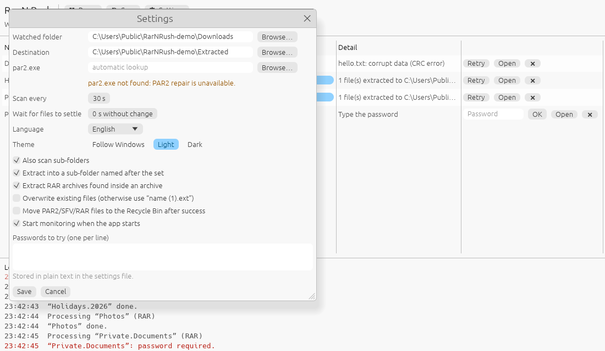

# Settings reference

**English** · [Français](OPTIONS.fr.md)

Every setting is available in the **Settings** window and stored in `rar-n-rush.toml`. That file sits next to `rar-n-rush.exe` (portable mode), or in `%APPDATA%\RarNRush` when the program folder is not writable.

Missing keys take their default value, so an old or partial file keeps working. Out-of-range numbers are clamped to the allowed range when the file is loaded.



## Folders

| Key | Window label | Type | Default | Effect |
|---|---|---|---|---|
| `watch_dir` | Watched folder | path | *(empty)* | Folder scanned for new sets. Empty means monitoring cannot start. |
| `extract_dir` | Destination | path | *(empty)* | Where archives are extracted. Empty means "next to the source files". When it is inside the watched folder, it is excluded from scans. |
| `par2_path` | par2.exe | path | *(empty)* | Path to `par2.exe`. Empty means automatic lookup: next to `rar-n-rush.exe`, then in `PATH`. The window shows the resolved path, or a warning if none is found. |

## Timing

| Key | Window label | Type | Default | Range | Effect |
|---|---|---|---|---|---|
| `scan_interval_secs` | Scan every | seconds | `15` | 2–3600 | Delay between two scans of the watched folder. **Scan** in the toolbar forces a scan. |
| `stable_secs` | Wait for files to settle | seconds | `10` | 0–3600 | A set is processed only after its files (count, size, modification time) have not changed for this long. |

## Behaviour

| Key | Window label | Type | Default | Effect |
|---|---|---|---|---|
| `recursive` | Also scan sub-folders | bool | `true` | Scan sub-folders, up to 8 levels deep. Symbolic links are not followed. |
| `create_subfolder` | Extract into a sub-folder named after the set | bool | `true` | Extracts `Holidays.part1.rar` into `<destination>\Holidays\`. Characters forbidden by Windows are replaced with `_`. |
| `extract_nested` | Extract RAR archives found inside an archive | bool | `true` | Extracts archives found in an extracted archive (up to 3 levels), then deletes those inner archives. |
| `overwrite_existing` | Overwrite existing files | bool | `false` | When `false`, an existing file is kept and the extracted copy is named `name (1).ext`, `name (2).ext`… |
| `delete_after_success` | Move PAR2/SFV/RAR files to the Recycle Bin after success | bool | `false` | After a successful run, sends the PAR2 files, the SFV, the RAR volumes and par2 backups (`file.1`) to the Recycle Bin. Verified non-RAR files are always kept. |
| `autostart` | Start monitoring when the app starts | bool | `true` | Starts monitoring on launch when a watched folder is set. |

## Passwords

| Key | Window label | Type | Default | Effect |
|---|---|---|---|---|
| `passwords` | Passwords to try (one per line) | list of text | `[]` | Tried in order on protected archives. A password typed in a row of the main window is tried first. |

> **Warning**: in this version, passwords are stored in plain text in `rar-n-rush.toml`. Moving them to the Windows Credential Manager is planned for v0.3.0 (see [ROADMAP.md](../ROADMAP.md)).

## Appearance

| Key | Window label | Values | Default | Effect |
|---|---|---|---|---|
| `language` | Language | `system`, `english`, `french` | `system` | Interface language. `system` follows the Windows display language (French if it starts with `fr`, English otherwise). |
| `theme` | Theme | `system`, `light`, `dark` | `system` | `system` follows the Windows light/dark setting, live. |

## Example file

```toml
watch_dir = 'D:\Downloads'
extract_dir = 'D:\Extracted'
create_subfolder = true
recursive = true
par2_path = ''
delete_after_success = false
extract_nested = true
overwrite_existing = false
scan_interval_secs = 15
stable_secs = 10
passwords = []
autostart = true
language = "system"
theme = "system"
```

## Other files

| File | Content |
|---|---|
| `rar-n-rush-processed.txt` | One line per set already processed or skipped, so it is not processed again after a restart. Delete a line (or the file) to process a set again. |
