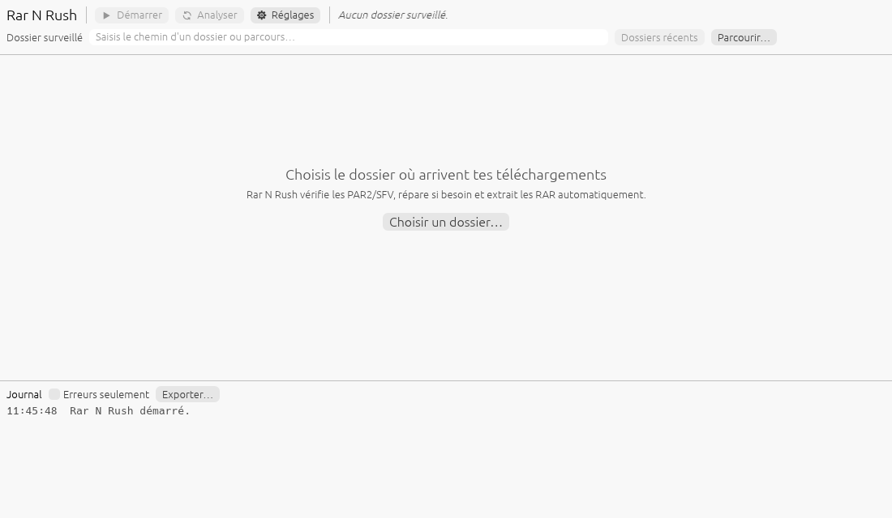
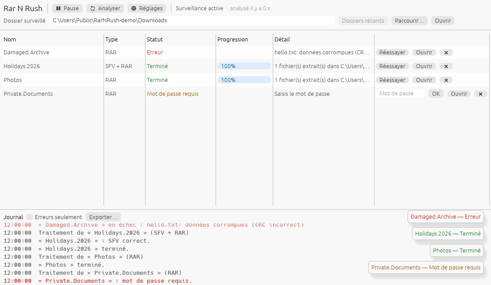
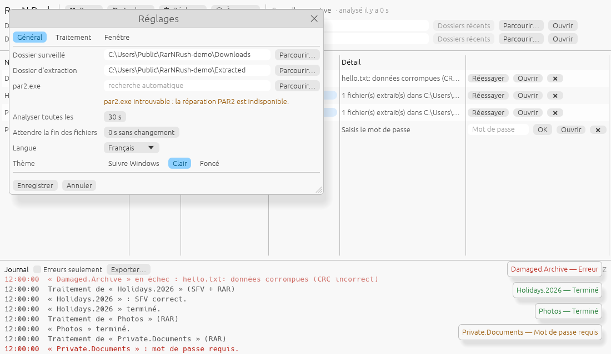
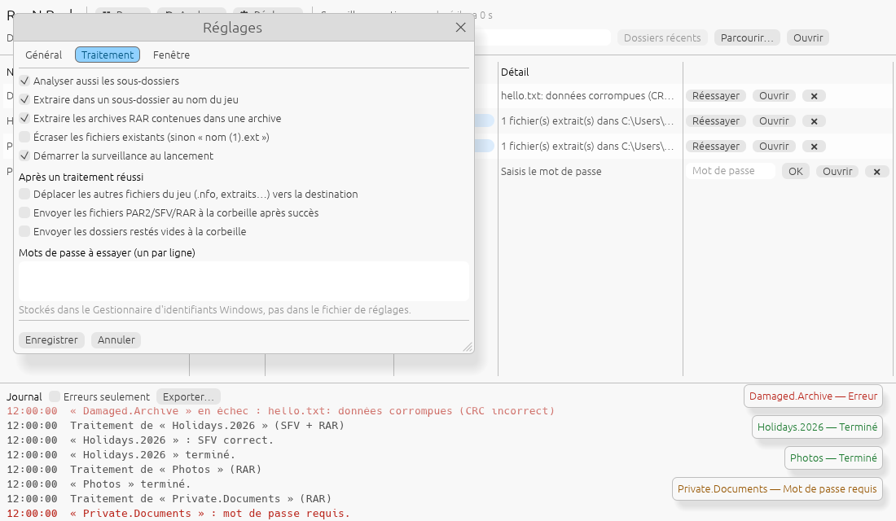
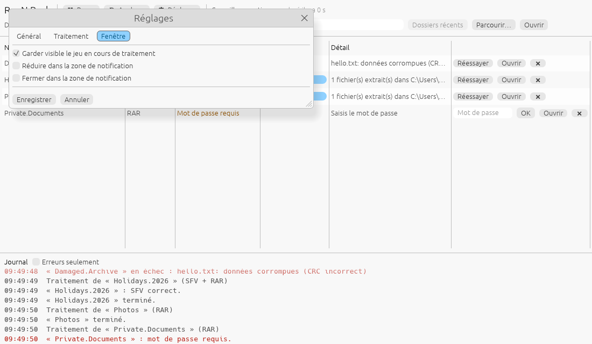
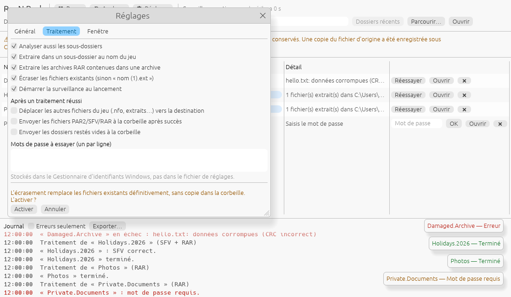
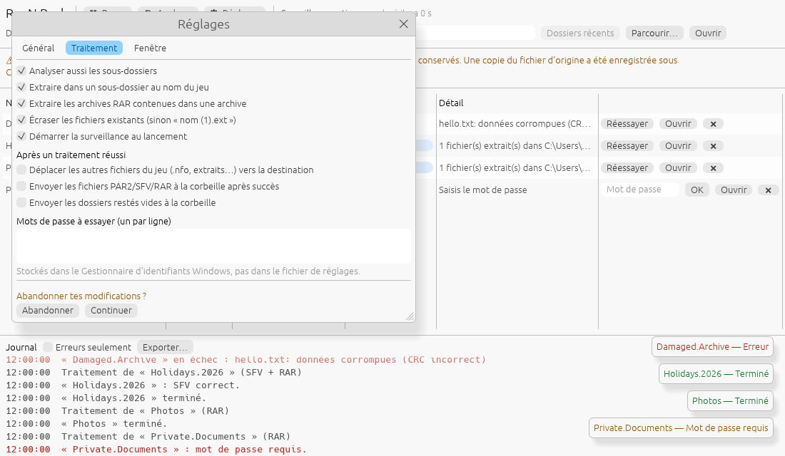
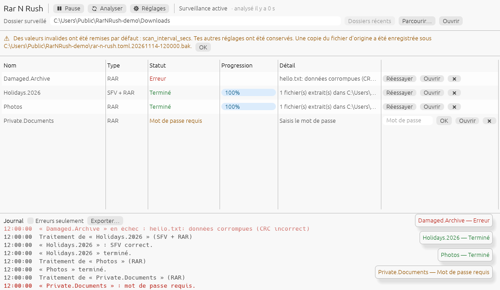

# Guide utilisateur

[English](USER-GUIDE.md) · **Français**

Ce guide parcourt chaque écran de Rar N Rush. Pour le nom exact, la valeur par défaut et les limites de chaque réglage, voir [OPTIONS.fr.md](OPTIONS.fr.md).

- [1. Installation et premier lancement](#1-installation-et-premier-lancement)
- [2. La fenêtre principale](#2-la-fenêtre-principale)
- [3. Ce qui arrive à un jeu de fichiers](#3-ce-qui-arrive-à-un-jeu-de-fichiers)
- [4. Mots de passe](#4-mots-de-passe)
- [5. Quand quelque chose ne va pas](#5-quand-quelque-chose-ne-va-pas)
- [6. Réglages](#6-réglages)
- [7. Fonctionner en arrière-plan](#7-fonctionner-en-arrière-plan)
- [8. Si le fichier de réglages a un problème](#8-si-le-fichier-de-réglages-a-un-problème)
- [9. Raccourcis clavier](#9-raccourcis-clavier)
- [10. Fichiers, vie privée et désinstallation](#10-fichiers-vie-privée-et-désinstallation)
- [11. Questions](#11-questions)

## 1. Installation et premier lancement

1. Télécharge `rar-n-rush-vX.Y.Z-windows-x64.zip` depuis la page [Releases](https://github.com/werewolf004/Rar-N-Rush/releases) et décompresse-le où tu veux, par exemple dans `C:\Outils\Rar N Rush`.
2. Lance `rar-n-rush.exe`. Rien n'est installé : les réglages sont créés à côté (ou dans `%APPDATA%\RarNRush` si ce dossier est en lecture seule).
3. La fenêtre demande le dossier où arrivent tes téléchargements :

Clique sur **Choisir un dossier…**, ou tape un chemin dans le champ **Dossier surveillé** et valide avec **Entrée**. La surveillance démarre aussitôt.

> Au premier lancement, Windows peut afficher un avertissement SmartScreen (« Windows a protégé votre ordinateur »), car le programme n'est pas signé avec un certificat payant. Clique sur **Informations complémentaires → Exécuter quand même**. Tu peux vérifier que le zip vient bien de ce projet avec le fichier `.sha256` ou `gh attestation verify` (voir le [README](../README.fr.md#installation)).

## 2. La fenêtre principale

**Barre d'outils** (première ligne)

| Élément | Rôle |
|---|---|
| **⏸ Pause** / **▶ Démarrer** | Suspend ou reprend la surveillance. Un jeu en cours de traitement se termine d'abord. |
| **🔄 Analyser** | Regarde le dossier tout de suite au lieu d'attendre la prochaine analyse (**F5**). |
| **⚙ Réglages** | Ouvre les réglages (**Ctrl+,**). |
| *Surveillance active · analysé il y a 2 s* | État actuel et temps depuis la dernière analyse. |

**Barre du dossier surveillé** (deuxième ligne) : tu peux changer de dossier à tout moment, même pendant un traitement. Tape un chemin et valide avec **Entrée** (**Échap** annule la saisie), choisis l'un des dix derniers dans **Dossiers récents**, ou clique sur **Parcourir…**. **Ouvrir** affiche le dossier dans l'Explorateur.

**Liste des jeux** : un *jeu* regroupe tout ce qui appartient à un même téléchargement : volumes RAR, fichiers PAR2, fichier SFV. Une ligne par jeu :

| Colonne | Contenu |
|---|---|
| Nom | Nom du jeu, tiré de ses fichiers (`Vacances.2026.part1.rar` → `Vacances.2026`). |
| Type | Ce qui a été trouvé : `RAR`, `SFV + RAR`, `PAR2 + RAR`, `PAR2`, `SFV`. |
| Statut | Voir le tableau ci-dessous. |
| Progression | Avancement de l'étape en cours. |
| Détail | Où sont allés les fichiers, ou pourquoi ça a échoué. |
| *(boutons)* | **Réessayer** (relancer), **Ignorer** (ne pas traiter ; l'annule s'il est en cours), **Ouvrir** (dossier dans l'Explorateur), **✕** (retirer la ligne ; les fichiers ne sont pas touchés). |

| Statut | Signification |
|---|---|
| En attente | Des fichiers arrivent ou changent encore. |
| Prêt | Complet, attend son tour (les jeux sont traités un par un). |
| Vérification / Réparation / Extraction | En cours de traitement. |
| Mot de passe requis | Saisis le mot de passe dans la ligne et valide avec **Entrée** (voir [Mots de passe](#4-mots-de-passe)). |
| Réparation impossible | Pas assez de blocs de récupération PAR2 : le jeu attend et repart tout seul dès que de nouveaux fichiers arrivent. |
| Terminé | Extrait avec succès. |
| Erreur | La colonne **Détail** et le journal disent pourquoi ; **Réessayer** le relance. |
| Ignoré | Ignoré par toi ; **Réessayer** le traite quand même. |

Clique sur une ligne (ou utilise **↑/↓**) pour la sélectionner : **Suppr** la retire de la liste, **Entrée** ouvre son dossier.

**Journal** (en bas) : une ligne par événement, la plus récente en bas. **Erreurs seulement** masque le reste. **Exporter…** enregistre les lignes affichées dans le fichier texte de ton choix, par exemple pour le joindre à un rapport de bug.

**Messages** : quand un jeu se termine, échoue ou demande un mot de passe, un court message apparaît six secondes en bas à droite, sans prendre le focus (visible sur les captures de la [section 6](#6-réglages)).

La fenêtre se rouvre à la taille et à la position qu'elle avait à la fermeture.

## 3. Ce qui arrive à un jeu de fichiers

1. **Attente de la fin du téléchargement.** Un jeu n'est touché qu'une fois qu'aucun de ses fichiers n'a changé depuis un moment (10 secondes par défaut). Un téléchargement en cours n'est jamais lu.
2. **Vérification.** Avec des fichiers PAR2, `par2.exe` (fourni dans le zip) contrôle chaque fichier. Avec un fichier SFV, c'est le CRC32 de chaque fichier qui est contrôlé. Un jeu sans l'un ni l'autre passe directement à l'extraction.
3. **Réparation.** Si un fichier est abîmé ou manquant et qu'il y a assez de blocs de récupération PAR2, il est reconstruit. S'il n'y en a pas assez, le jeu affiche **Réparation impossible** et attend : quand d'autres volumes PAR2 arrivent, il repart tout seul.
4. **Extraction.** Les archives RAR (multi-volumes `.partN.rar` ou `.rar` + `.r00`) sont extraites dans le dossier de destination, par défaut dans un sous-dossier au nom du jeu. Les archives trouvées à l'intérieur sont extraites aussi.
   - Les fichiers existants ne sont **jamais écrasés** par défaut : `nom (1).ext` est utilisé à la place.
   - L'espace libre est vérifié d'abord ; s'il ne suffit pas, rien n'est écrit et le jeu échoue en indiquant les tailles nécessaire et disponible.
   - Si l'extraction échoue ou est annulée, les fichiers qu'elle a créés sont supprimés : **Réessayer** repart de zéro.
5. **Après un traitement réussi** (facultatif, désactivé par défaut) : les autres fichiers du jeu (`.nfo`, extraits…) le suivent dans la destination, les fichiers sources vont à la **corbeille**, et les dossiers restés vides aussi. Rien n'est jamais supprimé définitivement.

Un jeu traité est mémorisé : il n'est pas retraité après un redémarrage. Pour le retraiter, clique sur **Réessayer**.

## 4. Mots de passe

Deux façons, qui se combinent :

- **Une liste essayée automatiquement** : dans **Réglages → Traitement → Mots de passe à essayer**, un par ligne. Chaque mot de passe est essayé à tour de rôle sur chaque archive protégée.
- **Saisi à la demande** : un jeu dont le mot de passe n'est pas dans la liste affiche **Mot de passe requis**. Tape le mot de passe dans le champ de la ligne et valide avec **Entrée** (ou **OK**). Un mauvais mot de passe est signalé, et tu peux en saisir un autre.

La liste est conservée dans le **Gestionnaire d'identifiants Windows**, protégé par ton compte Windows, et non dans le fichier de réglages. Tu peux la voir dans *Panneau de configuration → Gestionnaire d'identification → Informations d'identification Windows*, sous des noms commençant par `passwords` (service `RarNRush`). Les mots de passe n'apparaissent jamais dans le journal ni dans le fichier journal.

Si le Gestionnaire d'identifiants ne peut pas être utilisé, les mots de passe restent en clair dans le fichier de réglages, pour qu'aucun ne soit perdu, et la fenêtre te le dit.

## 5. Quand quelque chose ne va pas

| Ce que tu vois | Que faire |
|---|---|
| **Erreur** — *données corrompues (CRC incorrect)* | L'archive est abîmée et il n'y avait pas de PAR2 pour la réparer. Récupère les volumes PAR2 manquants ou retélécharge l'archive, puis **Réessayer**. |
| **Réparation impossible** | Pas assez de blocs de récupération. Rien à faire : le jeu repart tout seul quand d'autres volumes PAR2 arrivent. |
| **Erreur** — *espace libre insuffisant* | Libère de la place sur le disque de destination (le message donne les tailles), puis **Réessayer**. |
| **Mot de passe requis** | Voir [Mots de passe](#4-mots-de-passe). **Ignorer** si tu ne l'as pas. |
| *par2.exe introuvable* | Garde `par2.exe` à côté de `rar-n-rush.exe`, ou indique son chemin dans **Réglages → Général**. |
| Autre chose | Lis la ligne en rouge dans le journal. Avec **Écrire aussi le journal dans rar-n-rush.log** activé (par défaut), le journal complet et daté est dans `rar-n-rush.log`, à côté des réglages. |

## 6. Réglages

**⚙ Réglages** ouvre une fenêtre à trois pages. Rien ne change tant que tu n'as pas cliqué sur **Enregistrer** ; **Enregistrer** est désactivé, avec la raison affichée juste au-dessus, tant qu'une valeur est incorrecte (un dossier qui n'existe pas, par exemple).

**Général** : dossiers, `par2.exe`, délais, langue et thème.

**Traitement** : quoi extraire et comment, quoi faire après un traitement réussi, et les mots de passe à essayer.

**Fenêtre** : liste, journal, messages, zone de notification et démarrage avec Windows (voir la [section 7](#7-fonctionner-en-arrière-plan)).

Deux choix demandent confirmation :

- **Écraser les fichiers existants** est le seul choix irréversible : un fichier écrasé ne va pas dans la corbeille. L'activer demande une confirmation à l'enregistrement.

  

- Fermer les réglages avec **Annuler**, **Échap** ou **✕** alors que quelque chose a changé demande s'il faut abandonner les modifications.

  

La langue et le thème suivent Windows par défaut, et changent en direct quand tu les modifies dans Windows.

## 7. Fonctionner en arrière-plan

Tout se règle dans **Réglages → Fenêtre**.

- **Réduire dans la zone de notification** / **Fermer dans la zone de notification** : la fenêtre se cache et une icône reste près de l'horloge. Clique dessus, ou choisis **Afficher Rar N Rush** dans son menu, pour faire revenir la fenêtre ; **Quitter** dans le même menu ferme le programme. La surveillance continue pendant que la fenêtre est cachée.
- **Notifications Windows quand la fenêtre n'est pas au premier plan** (activé par défaut) : quand un jeu se termine, échoue ou demande un mot de passe alors que la fenêtre est cachée, réduite ou derrière une autre fenêtre, Windows affiche une notification. Clique dessus pour faire revenir la fenêtre. Elles suivent tes réglages Windows (*Ne pas déranger*, et l'interrupteur de Rar N Rush dans *Paramètres → Système → Notifications*).
- **Démarrer avec Windows (réduit)** (désactivé par défaut) : Rar N Rush démarre à l'ouverture de ta session, réduit, ou seulement en icône si *Réduire dans la zone de notification* est activé. Si tu déplaces le programme, l'entrée le suit au lancement suivant.
- **Une seule instance à la fois** : relancer Rar N Rush pendant qu'il tourne ramène simplement la fenêtre ouverte au premier plan.

## 8. Si le fichier de réglages a un problème

Rar N Rush ne jette jamais tes réglages. Si le fichier a été modifié à la main et qu'une valeur est incorrecte, seule cette valeur revient à sa valeur par défaut ; une copie du fichier d'origine est faite avant, et un bandeau indique quelle clé et où est la copie :

Clique sur **OK** pour le masquer. Les autres cas sont traités de la même façon, sans rien perdre :

- **Enregistré par le Bloc-notes en « ANSI »** au lieu d'UTF-8 (fréquent quand un chemin contient des accents) : le fichier est quand même lu correctement, une copie est conservée, et il est réécrit en UTF-8.
- **Endommagé** (TOML invalide) : les valeurs par défaut sont utilisées et le fichier est d'abord copié à côté.
- **Illisible** (verrouillé par un autre programme, droits) : les valeurs par défaut sont utilisées pour cette session, et ton fichier n'est **jamais remplacé** tant qu'il est illisible.
- **Gestionnaire d'identifiants indisponible au démarrage** : tes mots de passe enregistrés ne sont pas utilisables pendant cette session, et ils ne sont **jamais écrasés** ; ceux saisis entre-temps attendent dans le fichier de réglages et les rejoignent au lancement suivant.

## 9. Raccourcis clavier

| Raccourci | Action |
|---|---|
| **F5** | Analyser le dossier surveillé maintenant |
| **Ctrl+,** | Ouvrir les réglages |
| **Échap** | Fermer les réglages (demande d'abord si quelque chose a changé) ; dans le champ du dossier surveillé, annuler la saisie |
| **Entrée** | Dans le champ du dossier surveillé, surveiller le dossier saisi ; dans un champ de mot de passe, essayer le mot de passe ; avec un jeu sélectionné, ouvrir son dossier |
| **↑ / ↓** | Sélectionner un jeu dans la liste |
| **Suppr** | Retirer le jeu sélectionné de la liste (ses fichiers ne sont pas touchés) |
| **Tab** | Passer d'un contrôle à l'autre (chaque contrôle est accessible et nommé pour les lecteurs d'écran) |

## 10. Fichiers, vie privée et désinstallation

Rar N Rush **ne se connecte jamais à Internet** : aucune vérification de mise à jour, aucune télémétrie. Pour mettre à jour, télécharge une nouvelle release quand tu le veux et remplace les fichiers.

À côté des réglages (dossier de `rar-n-rush.exe`, ou `%APPDATA%\RarNRush`) :

| Fichier | Contenu |
|---|---|
| `rar-n-rush.toml` | Réglages ([OPTIONS.fr.md](OPTIONS.fr.md)). |
| `rar-n-rush-processed.txt` | Jeux déjà traités, pour ne pas les retraiter. |
| `rar-n-rush.log`, `.log.1` … `.3` | Fichier journal, s'il est activé. |
| `rar-n-rush.lock`, `rar-n-rush.show` | Servent à garder une seule instance en marche. |
| `rar-n-rush.ico` | Icône des notifications Windows, si elles sont activées. |

**Pour retirer complètement Rar N Rush :**

1. Dans **Réglages → Fenêtre**, désactive **Démarrer avec Windows** et **Notifications Windows**, puis **Enregistrer** : cela supprime les deux entrées de registre qu'ils utilisent (toutes deux sous ton propre compte, `HKEY_CURRENT_USER`).
2. Dans **Réglages → Traitement**, vide **Mots de passe à essayer**, puis **Enregistrer** : cela les supprime du Gestionnaire d'identifiants.
3. Quitte le programme (depuis le menu de l'icône si elle est affichée) et supprime le dossier du programme, ainsi que `%APPDATA%\RarNRush` s'il existe.

## 11. Questions

**Est-ce qu'il supprime mes fichiers ?** Jamais définitivement. Les fichiers sources ne vont qu'à la corbeille, seulement après un traitement entièrement réussi, et seulement si tu l'actives.

**Peut-il écraser des fichiers ?** Pas par défaut (`nom (1).ext` est utilisé). L'activer demande une confirmation.

**Un jeu ne démarre pas.** Il attend que ses fichiers ne changent plus ; vérifie *En attente* dans la liste. **🔄 Analyser** (**F5**) regarde le dossier tout de suite.

**Puis-je surveiller plusieurs dossiers ?** Un à la fois ; on change instantanément depuis la barre **Dossier surveillé**, et **Dossiers récents** garde les dix derniers. Avec **Analyser aussi les sous-dossiers**, un dossier parent couvre tous ses sous-dossiers.

**Où signaler un problème ?** Sur le [suivi des tickets](https://github.com/werewolf004/Rar-N-Rush/issues) du projet, avec le journal exporté si possible. Problèmes de sécurité : voir [SECURITY.fr.md](../SECURITY.fr.md).
