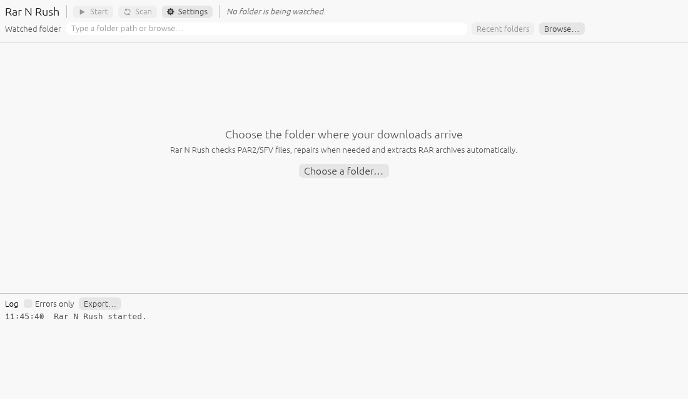
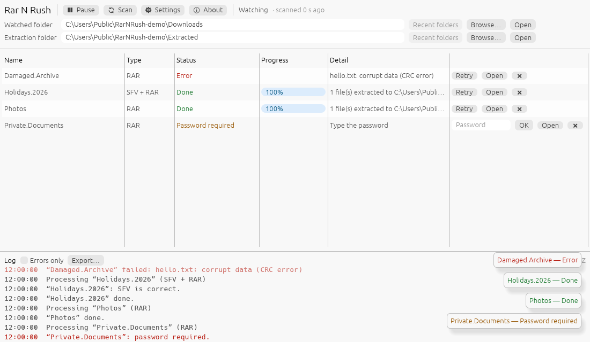
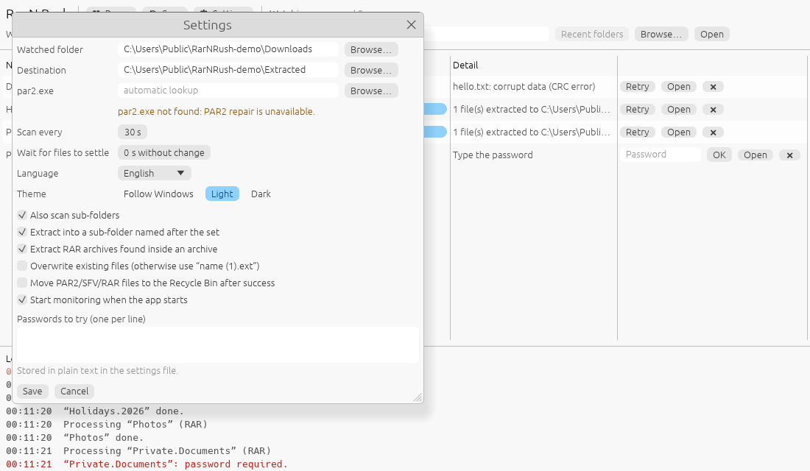
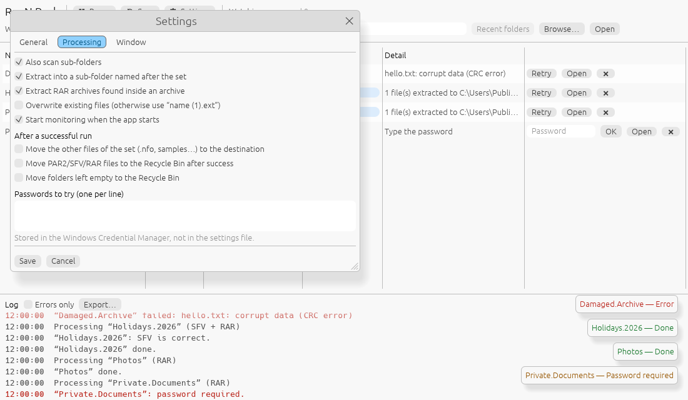
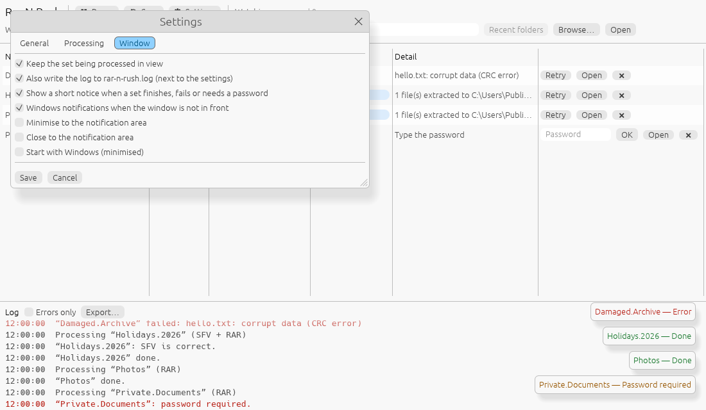
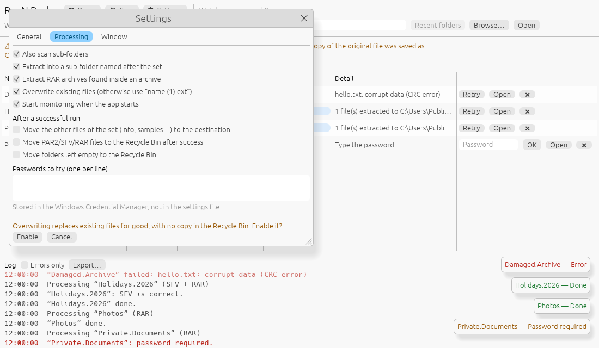
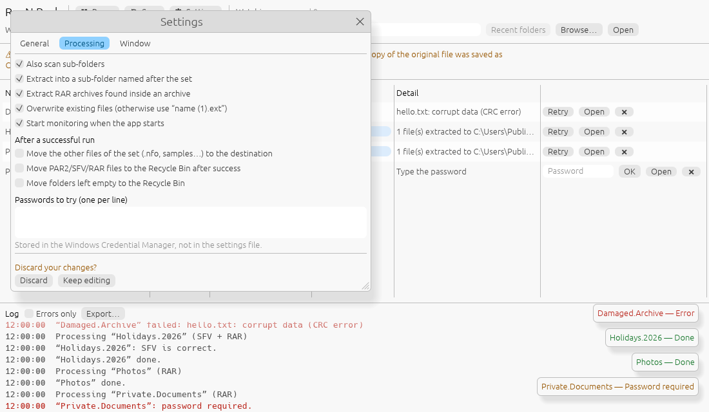
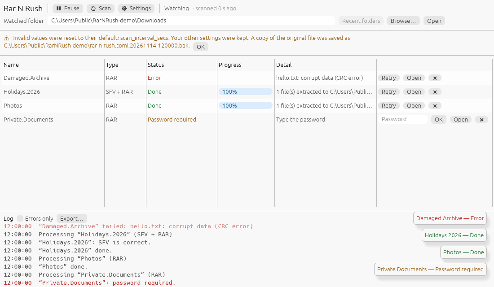

# User guide

**English** · [Français](USER-GUIDE.fr.md)

This guide walks through every screen of Rar N Rush. For the exact name, default and range of each setting, see [OPTIONS.md](OPTIONS.md).

- [1. Install and first start](#1-install-and-first-start)
- [2. The main window](#2-the-main-window)
- [3. What happens to a set of files](#3-what-happens-to-a-set-of-files)
- [4. Passwords](#4-passwords)
- [5. When something goes wrong](#5-when-something-goes-wrong)
- [6. Settings](#6-settings)
- [7. Running in the background](#7-running-in-the-background)
- [8. If the settings file has a problem](#8-if-the-settings-file-has-a-problem)
- [9. Keyboard shortcuts](#9-keyboard-shortcuts)
- [10. Files, privacy and removal](#10-files-privacy-and-removal)
- [11. Questions](#11-questions)

## 1. Install and first start

1. Download `rar-n-rush-vX.Y.Z-windows-x64.zip` from the [Releases](https://github.com/werewolf004/Rar-N-Rush/releases) page and unzip it anywhere, for example in `C:\Tools\Rar N Rush`.
2. Run `rar-n-rush.exe`. Nothing is installed: the settings are created next to it (or in `%APPDATA%\RarNRush` when that folder is read-only).
3. The window asks for the folder where your downloads arrive:

Click **Choose a folder…**, or type a path in the **Watched folder** field and press **Enter**. Monitoring starts at once.

> Windows may show a SmartScreen warning the first time ("Windows protected your PC"), because the program is not signed with a paid certificate. Click **More info → Run anyway**. You can check that the zip really comes from this project with the `.sha256` file or `gh attestation verify` (see the [README](../README.md#installation)).

## 2. The main window

**Toolbar** (top line)

| Item | What it does |
|---|---|
| **⏸ Pause** / **▶ Start** | Suspends or resumes monitoring. A set being processed finishes first. |
| **🔄 Scan** | Looks at the folder now instead of waiting for the next scan (**F5**). |
| **⚙ Settings** | Opens the settings (**Ctrl+,**). |
| *Watching · scanned 2 s ago* | Current state and time since the last scan. |

**Watched folder bar** (second line): you can change the folder at any time, even while sets are being processed. Type a path and press **Enter** (**Esc** cancels the edit), pick one of the last ten under **Recent folders**, or click **Browse…**. **Open** shows the folder in File Explorer.

**List of sets**: a *set* is everything that belongs to one download: RAR volumes, PAR2 files, SFV file. One row per set:

| Column | Content |
|---|---|
| Name | Name of the set, taken from its files (`Holidays.2026.part1.rar` → `Holidays.2026`). |
| Type | What was found: `RAR`, `SFV + RAR`, `PAR2 + RAR`, `PAR2`, `SFV`. |
| Status | See the table below. |
| Progress | Progress of the current step. |
| Detail | Where the files went, or why it failed. |
| *(buttons)* | **Retry** (run again), **Skip** (do not process; cancels it if running), **Open** (folder in File Explorer), **✕** (remove the row; the files are not touched). |

| Status | Meaning |
|---|---|
| Waiting | Files are still arriving or changing. |
| Ready | Complete, waiting for its turn (sets are processed one at a time). |
| Verifying / Repairing / Extracting | Being processed. |
| Password required | Type the password in the row and press **Enter** (see [Passwords](#4-passwords)). |
| Repair impossible | Not enough PAR2 recovery blocks: the set waits and is tried again as soon as new files arrive. |
| Done | Extracted successfully. |
| Error | The **Detail** column and the log say why; **Retry** runs it again. |
| Skipped | Ignored by you; **Retry** processes it anyway. |

Click a row (or use **↑/↓**) to select it: **Del** removes it from the list, **Enter** opens its folder.

**Log** (bottom): one line per event, newest at the bottom. **Errors only** hides the rest. **Export…** saves the lines shown to a text file you choose, for example to attach to a bug report.

**Notices**: when a set finishes, fails or needs a password, a short notice appears for six seconds in the bottom-right corner, without taking the focus (visible in the screenshots of [section 6](#6-settings)).

The window reopens at the size and position it had when you closed it.

## 3. What happens to a set of files

1. **Waiting for the download to end.** A set is only touched once none of its files has changed for a while (10 seconds by default). Downloads in progress are never read.
2. **Verification.** With PAR2 files, `par2.exe` (shipped in the zip) checks every file. With an SFV file, the CRC32 of each file is checked. A set with neither goes straight to extraction.
3. **Repair.** If a file is damaged or missing and there are enough PAR2 recovery blocks, it is rebuilt. If there are not enough, the set shows **Repair impossible** and waits: when more PAR2 volumes arrive, it is tried again by itself.
4. **Extraction.** The RAR archives (multi-volume `.partN.rar` or `.rar` + `.r00`) are extracted to the destination folder, in a sub-folder named after the set by default. Archives found inside the archive are extracted too.
   - Existing files are **never overwritten** by default: `name (1).ext` is used instead.
   - The free space is checked first; if it is not enough, nothing is written and the set fails with the sizes needed and available.
   - If extraction fails or is cancelled, the files it created are removed, so **Retry** starts clean.
5. **After a successful run** (optional, off by default): the other files of the set (`.nfo`, samples…) follow it to the destination, the source files go to the **Recycle Bin**, and folders left empty go to the Recycle Bin. Nothing is ever deleted permanently.

A processed set is remembered: it is not processed again after a restart. To process it again, click **Retry**.

## 4. Passwords

Two ways, which can be combined:

- **A list tried automatically**: in **Settings → Processing → Passwords to try**, one per line. Each password is tried in turn on every protected archive.
- **Typed when asked**: a set whose password is not in the list shows **Password required**. Type the password in the row's field and press **Enter** (or **OK**). A wrong password is reported, and you can type another.

The list is kept in the **Windows Credential Manager**, protected by your Windows account, not in the settings file. You can see it in *Control Panel → Credential Manager → Windows Credentials*, under names starting with `passwords` (service `RarNRush`). Passwords never appear in the log or in the log file.

If the Credential Manager cannot be used, the passwords stay in the settings file in plain text, so that none is lost, and the window tells you.

## 5. When something goes wrong

| What you see | What to do |
|---|---|
| **Error** — *corrupt data (CRC error)* | The archive is damaged and there was no PAR2 to repair it. Get the missing PAR2 volumes or download the archive again, then **Retry**. |
| **Repair impossible** | Not enough recovery blocks. Nothing to do: the set is tried again by itself when more PAR2 volumes arrive. |
| **Error** — *not enough free space* | Free some space on the destination drive (the message gives the sizes), then **Retry**. |
| **Password required** | See [Passwords](#4-passwords). **Skip** if you do not have it. |
| *par2.exe not found* | Keep `par2.exe` next to `rar-n-rush.exe`, or set its path in **Settings → General**. |
| Anything else | Read the line in red in the log. With **Also write the log to rar-n-rush.log** on (the default), the full log with dates is in `rar-n-rush.log` next to the settings. |

## 6. Settings

**⚙ Settings** opens a window with three pages. Nothing changes until you click **Save**; **Save** is disabled, with the reason shown above it, while a value is wrong (a folder that does not exist, for instance).

**General**: folders, `par2.exe`, timings, language and theme.

**Processing**: what to extract and how, what to do after a successful run, and the passwords to try.

**Window**: list, log, notices, notification area and start with Windows (see [section 7](#7-running-in-the-background)).

Two choices ask before going further:

- **Overwrite existing files** is the only irreversible choice: an overwritten file is not in the Recycle Bin. Turning it on asks for confirmation when you save.

  

- Closing the settings with **Cancel**, **Esc** or **✕** while something changed asks whether to discard the changes.

  

The language and theme follow Windows by default, and switch live when you change them in Windows.

## 7. Running in the background

All of these are in **Settings → Window**.

- **Minimise to the notification area** / **Close to the notification area**: the window hides and an icon stays next to the clock. Click it, or choose **Show Rar N Rush** in its menu, to bring the window back; **Quit** in the same menu exits. Monitoring goes on while the window is hidden.
- **Windows notifications when the window is not in front** (on by default): when a set finishes, fails or needs a password while the window is hidden, minimised or behind another window, Windows shows a notification. Click it to bring the window back. They follow your Windows settings (*Do not disturb*, and the switch for Rar N Rush in *Settings → System → Notifications*).
- **Start with Windows (minimised)** (off by default): Rar N Rush starts when you sign in, minimised, or only as an icon when *Minimise to the notification area* is on. If you move the program, the entry follows it at the next start.
- **One instance at a time**: starting Rar N Rush again while it runs simply brings the open window to the front.

## 8. If the settings file has a problem

Rar N Rush never throws your settings away. If the file was edited by hand and a value is wrong, only that value goes back to its default; a copy of the original file is saved first, and a banner tells you which key and where the copy is:

Click **OK** to hide it. The other cases are handled the same way, without losing anything:

- **Saved by Notepad in "ANSI"** instead of UTF-8 (common when a path has accents): the file is read correctly anyway, a copy is kept, and it is written back in UTF-8.
- **Damaged** (not valid TOML): the defaults are used and the file is copied aside first.
- **Cannot be read at all** (locked by another program, permissions): the defaults are used for this session, and your file is **never replaced** while it cannot be read.
- **Credential Manager unavailable at start-up**: your saved passwords are not usable in this session, and they are **never overwritten**; passwords typed meanwhile wait in the settings file and join them at the next start.

## 9. Keyboard shortcuts

| Shortcut | Action |
|---|---|
| **F5** | Scan the watched folder now |
| **Ctrl+,** | Open the settings |
| **Esc** | Close the settings (asks first if something changed); in the watched-folder field, cancel the edit |
| **Enter** | In the watched-folder field, watch the folder typed; in a password field, try the password; with a set selected, open its folder |
| **↑ / ↓** | Select a set in the list |
| **Del** | Remove the selected set from the list (its files are not touched) |
| **Tab** | Move between the controls (every control can be reached and is named for screen readers) |

## 10. Files, privacy and removal

Rar N Rush **never connects to the Internet**: no update check, no telemetry. To update, download a newer release when you want one and replace the files.

Next to the settings (`rar-n-rush.exe`'s folder, or `%APPDATA%\RarNRush`):

| File | Content |
|---|---|
| `rar-n-rush.toml` | Settings ([OPTIONS.md](OPTIONS.md)). |
| `rar-n-rush-processed.txt` | Sets already processed, so they are not processed again. |
| `rar-n-rush.log`, `.log.1` … `.3` | Log file, if enabled. |
| `rar-n-rush.lock`, `rar-n-rush.show` | Used to keep a single instance running. |
| `rar-n-rush.ico` | Icon of the Windows notifications, if enabled. |

**To remove Rar N Rush completely:**

1. In **Settings → Window**, turn off **Start with Windows** and **Windows notifications**, then **Save**: this removes the two registry entries they use (both under your own account, `HKEY_CURRENT_USER`).
2. In **Settings → Processing**, empty **Passwords to try**, then **Save**: this removes them from the Credential Manager.
3. Quit (from the tray icon's menu if it is shown) and delete the program folder, and `%APPDATA%\RarNRush` if it exists.

## 11. Questions

**Does it delete my files?** Never permanently. Source files only go to the Recycle Bin, only after a fully successful run, and only if you enable it.

**Can it overwrite files?** Not by default (`name (1).ext` is used). Enabling it asks for confirmation.

**A set does not start.** It waits until its files stop changing; check *Waiting* in the list. **🔄 Scan** (**F5**) looks at the folder now.

**Can I watch several folders?** One at a time; switching is instant from the **Watched folder** bar, and **Recent folders** keeps the last ten. With **Also scan sub-folders**, one parent folder covers all its sub-folders.

**Where do I report a problem?** On the project's [issue tracker](https://github.com/werewolf004/Rar-N-Rush/issues), with the exported log if possible. Security problems: see [SECURITY.md](../SECURITY.md).
